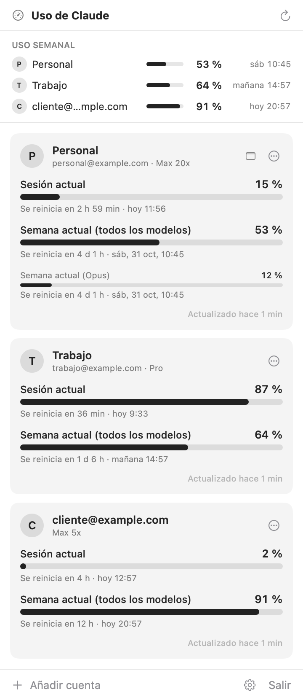
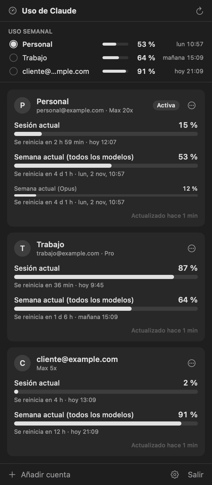
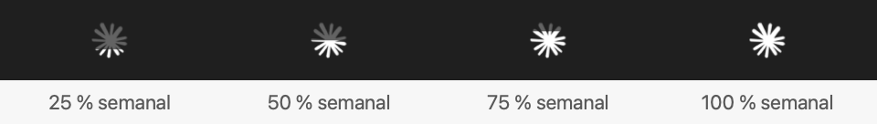

# Claude Session Monitor

App para la barra de menús de macOS que muestra cuánto llevas consumido de tus límites de Claude en **varias cuentas a la vez**: la sesión actual (ventana de 5 horas), el límite semanal y los límites semanales por modelo, con la hora exacta a la que se reinicia cada uno.

Si alternas entre varias cuentas de Claude (personal, trabajo, clientes…), de un vistazo sabes cuál tiene margen y cuándo se libera la que has agotado.

> [!NOTE]
> Proyecto personal y no oficial. No está afiliado a Anthropic ni cuenta con su respaldo. Usa endpoints internos de Claude que pueden cambiar sin previo aviso (ver [Limitaciones](#limitaciones)).

<p align="center">
  
  &nbsp;
  
</p>
<p align="center"><sub>Capturas con cuentas y datos de ejemplo.</sub></p>

## Qué hace

- **Resumen semanal arriba del todo**: una fila por cuenta con el porcentaje semanal consumido y cuándo se reinicia («hoy 20:57», «mañana 14:57», «sáb 10:45»).
- **Tarjeta por cuenta** con:
  - **Sesión actual**: la ventana de 5 horas, con cuenta atrás hasta el reinicio.
  - **Semana actual (todos los modelos)**: el límite semanal general.
  - **Límites semanales por modelo**, si tu plan los tiene.
- **Icono en la barra de menús**: el logo de Claude se rellena de abajo arriba según el uso semanal de la cuenta que elijas. Al lado puede mostrar el porcentaje de la sesión, el semanal, los dos o ninguno.
- **Avisos** del sistema cuando una cuenta llega al 80 % y al 95 % de la sesión o de la semana.
- **Actualización automática**: cada pocos minutos (configurable), al despertar el Mac y justo después de cada reinicio de ventana.
- Interfaz **monocroma**, que se adapta al modo claro y al oscuro.
- Opción para **abrirse al iniciar sesión** en el Mac.

## Requisitos

- macOS 14 Sonoma o posterior.
- Xcode 26 o posterior (Swift 6.2+) para compilar.
- Una o varias cuentas de [claude.ai](https://claude.ai) con suscripción (Pro, Max, Team…).
- Opcional: la [app de escritorio de Claude](https://claude.ai/download) instalada. De ella se toma la silueta del logo para el icono; si no está, se dibuja una parecida.

## Instalación

No hay binarios publicados: la app se compila en tu Mac en unos segundos.

```sh
git clone https://github.com/econdo/ClaudeSessionMonitor.git
cd ClaudeSessionMonitor
./build.sh install
```

`build.sh` compila en modo release, monta `ClaudeSessionMonitor.app`, la firma, la copia a `~/Applications` y la abre. Con `./build.sh` a secas solo genera `build/ClaudeSessionMonitor.app`.

**Firma.** El script usa el primer certificado «Apple Development» o «Developer ID Application» que encuentre en tu llavero, y puedes indicar otro con `SIGN_IDENTITY="…" ./build.sh install`. Si no tienes ninguno, firma *ad hoc*. Funciona igual, pero macOS te pedirá permiso para acceder al llavero cada vez que recompiles: pulsa «Permitir siempre».

## Uso

### Añadir una cuenta

1. Haz clic en el icono de la barra de menús y pulsa **Añadir cuenta**.
2. Pulsa **Abrir en el navegador**, inicia sesión en claude.ai con la cuenta que quieras añadir y pulsa **Autorizar**.
3. El navegador muestra «Cuenta añadida» y la cuenta aparece en el panel.

Repite el proceso con cada cuenta.

> [!TIP]
> El navegador autoriza la cuenta que tenga abierta en claude.ai. Para añadir otra distinta, pulsa **Copiar enlace** y ábrelo en una ventana privada (⇧⌘N) o en otro perfil del navegador. También puedes cerrar sesión en claude.ai antes de autorizar.

Si el navegador no consigue volver a la app tras autorizar, por ejemplo por un bloqueador o un proxy, pulsa **«¿El navegador no vuelve a la app? Usar un código»**: Claude te mostrará un código para pegar en la app.

### El icono de la barra de menús

<p align="center"></p>

El logo se rellena según el **uso semanal** de la cuenta elegida, y la parte sin consumir queda translúcida. Es una imagen de plantilla, así que macOS la pinta en blanco o en negro según el color de la barra. Si la sesión de esa cuenta caduca, aparece un `!`.

### Ajustes

Se abren con el engranaje, abajo a la derecha del panel.

| Ajuste | Qué hace |
| --- | --- |
| Actualizar cada | Frecuencia de consulta: 1, 2, 5 (por defecto), 10, 15 o 30 minutos |
| Cuenta en la barra | Qué cuenta representa el icono |
| Texto en la barra | Sesión actual, semanal, ambos o solo icono |
| Avisar al llegar al 80 % y 95 % | Notificaciones del sistema al cruzar esos umbrales |
| Abrir al iniciar sesión en el Mac | Arranque automático |

Desde el menú **⋯** de cada tarjeta puedes actualizar esa cuenta, mostrarla en la barra, renombrarla (por ejemplo «Trabajo»), volver a iniciar sesión, cambiar su orden o quitarla.

## Cómo funciona

```
┌────────────────────┐   1. OAuth + PKCE (navegador)   ┌─────────────────────────┐
│                    │ ──────────────────────────────► │ claude.ai               │
│  Claude Session    │ ◄── 2. redirección a localhost ─ │ (inicio de sesión)      │
│  Monitor           │                                  └─────────────────────────┘
│                    │   3. token de acceso             ┌─────────────────────────┐
│  tokens → llavero  │ ──────────────────────────────► │ api.anthropic.com       │
│                    │ ◄── 4. uso + hora de reinicio ── │ /api/oauth/usage        │
└────────────────────┘                                  └─────────────────────────┘
```

1. **Inicio de sesión.** Se usa OAuth 2.0 con PKCE contra claude.ai, el mismo flujo con el que inicia sesión Claude Code y con su identificador de cliente público. Mientras dura el login, la app abre un pequeño servidor HTTP en un puerto aleatorio que solo escucha en `127.0.0.1` y `::1`. Ahí recibe la redirección, comprueba el parámetro `state` y lo cierra.
2. **Tokens.** Los tokens de acceso y de renovación de cada cuenta se guardan en el **llavero de macOS**, un elemento por cuenta con el servicio `com.econdo.ClaudeSessionMonitor.oauth`. Se renuevan solos antes de caducar. Son independientes de los de Claude Code, así que añadir una cuenta aquí no cierra tu sesión allí.
3. **Consumo.** Se consulta `GET https://api.anthropic.com/api/oauth/usage`, el mismo dato que muestra el comando `/usage` de Claude Code: porcentaje usado y hora de reinicio de cada límite. El nombre y el plan de la cuenta salen de `/api/oauth/profile`.
4. **Ritmo de consultas.** Por defecto se consulta cada 5 minutos, además de al despertar el Mac y después de cada reinicio de ventana. Si el servidor responde `429`, la app espera lo que indique `Retry-After` antes de reintentar.

## Privacidad y seguridad

- **Sin servidores propios, telemetría ni analítica.** La app solo se comunica con los dominios de Anthropic: `claude.com` y `claude.ai` para el login, y `platform.claude.com` y `api.anthropic.com` para tokens y consumo.
- **Las credenciales nunca salen del llavero.** En las preferencias de la app (`UserDefaults`) solo se guardan la lista de cuentas (email, nombre, plan, nombre personalizado), los ajustes y la última lectura de consumo, para mostrarla nada más abrir el panel.
- **El servidor local de login** solo escucha en la interfaz de loopback, solo mientras hay un inicio de sesión en curso, y rechaza respuestas cuyo `state` no coincida.
- **Este repositorio no contiene credenciales ni datos de cuentas.** Las capturas usan cuentas ficticias.

## Limitaciones

- **Endpoints internos.** `/api/oauth/usage` y `/api/oauth/profile` no forman parte de la API pública de Anthropic. Su formato puede cambiar y la app dejaría de mostrar datos hasta que se adapte. Para resistir cambios menores, el código tolera campos desconocidos y vuelve al formato anterior (`five_hour` / `seven_day`) si falta la lista `limits`.
- **Identificador de cliente de Claude Code.** El inicio de sesión reutiliza el identificador público de Claude Code. Si Anthropic lo restringe, el login dejaría de funcionar.
- **Solo en español.** La interfaz no está traducida.
- **Sin notarizar.** Al compilar tú mismo la app, Gatekeeper no pone pegas. Si compartes el `.app` ya compilado con otra persona, su Mac lo bloqueará.

## Desinstalar

1. En **Ajustes**, desactiva **Abrir al iniciar sesión en el Mac**.
2. Ejecuta:

```sh
pkill -x ClaudeSessionMonitor
rm -rf ~/Applications/ClaudeSessionMonitor.app
defaults delete com.econdo.ClaudeSessionMonitor
# Borra los tokens del llavero (uno por cuenta añadida)
while security delete-generic-password -s com.econdo.ClaudeSessionMonitor.oauth >/dev/null 2>&1; do :; done
```

## Estructura del proyecto

```
ClaudeSessionMonitor/
├── Package.swift                 Paquete Swift (ejecutable, macOS 14+)
├── build.sh                      Compila, empaqueta, firma e instala la .app
├── Resources/Info.plist          Info.plist de la app (LSUIElement: sin icono en el Dock)
├── docs/                         Capturas del README
└── Sources/ClaudeSessionMonitor/
    ├── ClaudeSessionMonitorApp.swift   Punto de entrada: MenuBarExtra e icono de la barra
    ├── AccountStore.swift              Estado: cuentas, refresco, login, avisos y ajustes
    ├── ClaudeAPI.swift                 OAuth (PKCE, tokens), perfil y consumo
    ├── OAuthCallbackServer.swift       Servidor HTTP mínimo en loopback para la redirección
    ├── Keychain.swift                  Lectura y escritura de tokens en el llavero
    ├── MenuBarIcon.swift               Logo de Claude relleno según el uso semanal
    ├── Formatting.swift                Fechas, cuentas atrás y porcentajes
    ├── Models.swift                    Cuenta, tokens, límites y lecturas de consumo
    └── Views/                          Panel, resumen semanal, tarjetas, alta de cuenta y ajustes
```

No tiene dependencias externas: solo SwiftUI, AppKit, Network, CryptoKit, Security, ServiceManagement y UserNotifications.

## Licencia

Código abierto bajo la licencia [MIT No Attribution (MIT-0)](LICENSE). Puedes usarlo, copiarlo, modificarlo, distribuirlo y venderlo, también dentro de proyectos cerrados o comerciales, sin pedir permiso y sin tener que citar la fuente. Se ofrece tal cual, sin garantías.

## Aviso legal

Claude y Anthropic son marcas de Anthropic, PBC. Este es un proyecto independiente sin relación con Anthropic. El repositorio no incluye el logo de Claude: la app lo lee en tiempo de ejecución de la app de escritorio de Claude instalada en tu Mac. La licencia cubre el código de este repositorio y no da ningún derecho sobre esas marcas ni sobre el logo.
